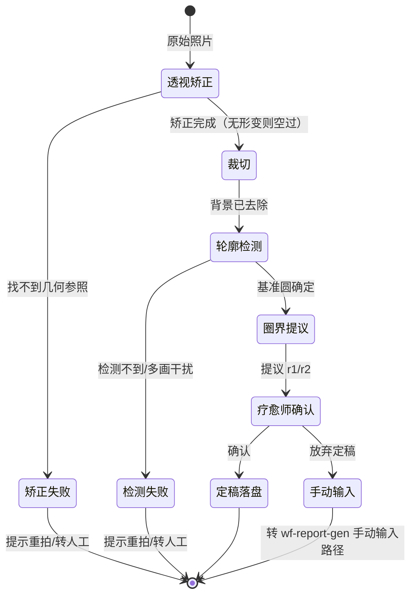

# input-prep.md - 输入预处理（WF-INPUT-PREP）

> 工作流编号：WF-INPUT-PREP ｜ 所属模块：服务模块 · 输入预处理 ｜ MVP 优先级：P0（报告生成前置）
>
> **版本**：v0.1.4　**更新日期**：2026-10-05
>
> 本文按四层结构编写：**设计层**（是什么、绝对不做什么）→ **控制层**（状态流转，含全部异常路径）→ **工程层**（用什么、不要什么）→ **验收层**（怎么算完成）。Spec 定稿后写代码完全以本文为准，不依赖口头补充；未定的事在文末「未决事项」显性列出，不留隐藏假设。

---

# 第一层：设计层（是什么、不是什么）

## 1.1 定位

输入预处理是解读报告生成（WF-REPORT-GEN）的**前置工作流**：把来访者随手拍摄的曼陀罗照片，加工成"矫正定稿图 + 结构化标记参数"，作为报告生成的实际输入（wf-report-gen §1.2 Step 0 的独立展开）。

核心性质：**确定性程序 + 疗愈师确认，全程不经 AI**。矫正与标记是几何问题，程序做比 AI 稳且可审计；圈界设定的专业判断保留给疗愈师（D-060/D-061）。

## 1.2 输入契约

| 参数 | 类型 | 必填 | 说明 |
|---|---|---|---|
| 原始照片 | JPEG/PNG | 是 | 来访者拍摄的曼陀罗画作照片；允许斜拍、含画纸外背景、手持、旋转 |
| 拍摄备注 | 文本 | 否 | 帮助程序判断的备注（如"装订本内页""画纸为方形"） |

## 1.3 输出契约

1. **定稿图（标记图）**：正方形；画作圆形居中；含两条三圈标记线（内/中分界 r1、中/外分界 r2）；**不含外轮廓圆**。定稿图是疗愈师视图；下游模型输入为**双幅**：原图（矫正裁切后、未叠加标记的版本）＋定稿标记图（D-120）
2. **标记参数 JSON**（结构化，随定稿图传递）：圆心 (cx, cy)、外半径 R、r1/r2（以 R 为基准的占比 0~1）——三圈占比的基准（0%~100%）与画作区域/背景的分界
3. **过程留痕**：检测到的基准圆参数、径向分析数据与圈界提议值、疗愈师调整前后四参数

## 1.4 绝对不做（Hard Boundaries）

1. **不做 AI 三圈划分**：圈界只由程序提议 + 疗愈师确认（D-060 已裁决，AI 三圈划分职责已移出）
2. **不在图上画外轮廓基准圆**：画出会干扰疗愈师对颜色的感知；下游（面积统计、归一化占比）全部从结构化参数取值，无需像素读外圈
3. **不自动定稿**：必须经疗愈师确认后才输出定稿；程序提议只是初值
4. **不改画作内容**：只做几何矫正、颜色校正与标记线叠加；不做颜色增强、滤镜、调色、修补、去阴影
5. **双幅不双轨（D-120 修订）**：不为模型生成带外圈的机器视图；但模型输入固定为双幅——原图负责一切视觉识别，标记图只用于三圈归属。实证依据：标记线被模型认错/漏检/当画作内容（2026-10-05 5079 事故）。程序实现上原图即矫正裁切产物，零额外成本

## 1.5 与下游契约

定稿图 + 四参数 → WF-REPORT-GEN Step 1：直接按标记线分圈识别，不再做 AI 三圈划分；**颜色面积统计完全代码化**（按标记区域分圈统计像素色相），视觉模型（Kimi K3，architecture.md §五）只负责颜色命名与语义判断——R-AI-003 归一化的主色相判定因此获得确定性面积输入。

---

# 第二层：控制层（状态流转，含全部异常路径）

## 2.1 总体状态机

顺序与人工修图一致：**先拉正 → 再裁掉背景 → 最后在干净的图里检测轮廓**。轮廓检测放最后，因为检测输入越干净（无斜拍形变、无背景干扰），基准圆越稳。



## 2.2 主流程步骤（每步：输入 / 任务 / 输出 / 失败处理）

**Step 1 透视矫正（程序）**
- 输入：原始照片
- 任务：检测画纸/画面的几何边界（斜拍下呈四边形），估计透视形变并做透视变换拉正，消化斜拍；拍摄基本正无时，本步为空操作直接通过
- 输出：拉正后的图像 + 形变度量（矫正前后的几何差异）
- 失败处理：画面明显倾斜但找不到可靠几何参照 → 异常路径

**Step 2 裁切（程序）**
- 任务：去除画纸外背景（桌面、手部、阴影、装订边等），裁到画作有效区域
- 输出：背景已去除的图像
- 失败处理：画作与背景无法可靠分离 → 异常路径（转人工，不猜）

**Step 3 外轮廓检测（程序）**
- 任务：在矫正、裁切后的干净图像上检测画作最外轮廓，确定基准圆（圆心 + 外半径 R）；圆检测（HoughCircles）与轮廓拟合双通道互验；画作外形非正圆（花瓣形、多瓣形）时取最外层闭合轮廓的**外接圆**为基准；**半径钳制不变量**：检测半径不得超出 Step 1/2 的 hint 圆（crop 按 hint 裁出，墨迹必在 hint 圆内）——最小外接圆会被轮廓毛刺撑大，越界即钳回 hint.r 并留痕
- 输出：基准圆参数 + 检测置信（圆度、边缘支撑比例）
- 失败处理：检测不到 / 置信不足 → 异常路径

**Step 4 圈界自动提议（程序）**
- 任务：以基准圆圆心为原点做径向**色差跳变**分析（对每个半径带，沿 720 个角度采样带内/外侧像素对，LAB 色差沿角度取平均；真分界在多数角度都分隔两个色区，组内纹理经角度平均后抵消），识别画面自然分区，r1/r2 各取区间内最强局部峰（r2 与 r1 保持最小间距）；中圈偏大或内圈偏大都是正常结果，不强制等分；哪些图案组进哪圈是专业判断，最终以疗愈师确认为准
- 输出：提议 r1/r2 + 结构清晰度得分
- 失败处理：结构不清晰、提不出可靠分界 → 退回固定比例（约 1/3、2/3）兜底，并标注"默认比例"；疗愈师仍可手调

**Step 5 疗愈师调整确认（交互，必经）**
- 任务：在矫正裁切后的图像上可视化叠加两条分界圆，支持拖拽调整（移动圆心、分别调整 r1/r2、整体缩放）；提供"恢复程序提议"与"恢复固定比例"快捷操作
- 输出：疗愈师确认后的四参数（圆心、R、r1、r2）
- 失败处理：放弃定稿 → 转手动输入路径；本步**不可跳过**

**Step 6 定稿落盘（程序）**
- 任务：把确认后的两条分界圆渲染为标记线（样式见未决事项 #1）生成定稿图；四参数与全程留痕落盘
- 输出：定稿图 + 标记参数 JSON + 留痕记录
- 失败处理：写盘失败 → 报错重试，原始照片与参数不丢

## 2.3 异常路径总表（每一条都是预设规则）

| 异常 | 检测点 | 处理规则 |
|---|---|---|
| 明显倾斜但找不到几何参照 | Step 1 | 提示重拍（正对画作、光线均匀）；重拍仍失败 → 转人工 |
| 画作与背景无法可靠分离 | Step 2 | 转人工，不猜 |
| 检测不到外轮廓 | Step 3 | 提示重拍（避免遮挡、入镜完整）；重拍仍失败 → 转人工或降级手动输入（wf-report-gen §1.2 手动输入契约） |
| 多幅画作/强干扰背景 | Step 3 | 取面积最大闭合轮廓；无法可靠区分 → 转人工，不猜 |
| 径向分析结构不清晰 | Step 4 | 固定比例兜底并标注"默认比例"；留痕结构清晰度得分 |
| 疗愈师放弃定稿 | Step 5 | 不产出定稿；转手动输入路径 |
| 程序异常 | 任一步 | 原始照片不删，可从 Step 1 重跑；写盘失败重试 |

---

# 第三层：工程层（用什么、不要什么）

## 3.1 技术红线（不要什么）

1. **不经 AI**：全流程确定性程序；不得为"更智能"把视觉模型引入本工作流
2. **不引入重量级 CV 框架**：OpenCV + NumPy 足够；新增依赖须经维护者确认
3. **颜色校正与颜色增强区分**：白平衡校准/色偏恢复属颜色校正（恢复真实颜色），允许在本工作流做——当前由疗愈师定稿时手工完成，后续程序化；颜色增强/滤镜/调色改变画作观感，禁止（低饱和淡彩画作对增强敏感）
4. **目录结构固定**：代码目录结构由 architecture.md 定义，不得自行发明

## 3.2 技术选型

| 环节 | 选型 | 说明 |
|---|---|---|
| 圆检测 | OpenCV HoughCircles + 轮廓拟合 | 双通道互验，取一致结果 |
| 透视矫正 | OpenCV getPerspectiveTransform | 以基准圆为参照 |
| 径向分布分析 | NumPy 径向采样 | 径向色差跳变（LAB 内外双环采样，沿角度平均） |
| 交互调整 | React 画布 | 拖拽式，嵌入疗愈师工作台 |

## 3.3 存储格式

- **定稿图**：`{case_id}/{painting_id}_final.jpg`
- **标记参数 JSON**：

```json
{
  "painting_id": "string",
  "center": {"x": 0.0, "y": 0.0},
  "R": 0.0,
  "r1": 0.0,
  "r2": 0.0,
  "unit": "R-ratio | pixel",
  "baseline_circle": {"center": {}, "R": 0.0, "confidence": 0.0},
  "proposal": {"r1": 0.0, "r2": 0.0, "clarity_score": 0.0, "fallback": false},
  "adjustment": {"adjusted": false, "delta_r1": 0.0, "delta_r2": 0.0},
  "created_at": "ISO8601"
}
```

- **原始照片**：租户内私有存储，留存与删除跟随个案数据策略（prd §5.2）

## 3.4 模块边界与黄金测试集

独立模块、独立可测，输入输出均为文件/参数，不依赖报告生成链路运行。

**黄金测试集 = `samples/paintings-raw/` 18 张真实照片**（已 gitignore，覆盖工况：大角度斜拍、装订本弯曲、手持入镜、画面旋转、照片含手写标注、非正圆外形等）；按新顺序（矫正→裁切→检测）逐张跑 Step 1-4，`m01-marked.jpeg` 为三圈标记线定稿参照样例。算法阈值以本集调参定，不拍脑袋。

---

# 第四层：验收层（怎么算完成）

## 4.1 验收指标

| 指标 | 目标值 | 测量方法 |
|---|---|---|
| 基准圆检测成功率 | ≥ 16/18（黄金集） | 逐张人工核对基准圆贴合画作外轮廓 |
| 矫正质量（轮廓圆度） | 长短轴比 ≥ 0.95 | 程序自动测量矫正后轮廓 |
| 圈界提议可用率 | 零调整或微调（\|Δr\| ≤ 0.05R）被疗愈师接受 ≥ 12/18 | 疗愈师试用记录（adjustment 留痕） |
| 单张处理时延（Step 1-3） | ≤ 5 秒 | 运行日志 |
| 标记参数与留痕完整性 | 100% 定稿含四参数 + 全程留痕 | 落盘校验 |

**实测（v0.1.2，黄金集 18 张）**：基准圆检测 18/18（含 1 张半径钳制留痕）；圈界提议 17 张、1 张正确走兜底（IMG_5610 稀疏点阵本就没有清晰三圈结构）；单张 Step 1-4 ≤0.6s。参照样例 m01：程序提议 r1=0.279 vs 人工 0.28（几乎重合）；r2=0.754 vs 人工 0.60——人工线本身穿过紫云带中部，属分组偏好差异，一次拖拽可修正。

## 4.2 验收用例（先给用例，再写实现）

黄金集逐张跑 Step 1-4（矫正→裁切→检测→提议），输出可视化中间结果（矫正拉正图、裁切结果、基准圆叠加、径向分析曲线、提议圈界叠加），人工核对：

1. **大角度斜拍**（如 IMG_5606-5608）：矫正后画作圆度达标、居中
2. **装订本/弯曲**（如 IMG_5609-5613）：基准圆不吞入装订边
3. **手持/阴影入镜**：检测不被人手轮廓带偏，或正确转入提示重拍
4. **旋转/倒置**：矫正结果与正向一致（与旋转无关性）
5. **含手写标注的照片**：标注笔迹不影响基准圆检测
6. **非正圆外形**（花瓣形等）：外接圆基准合理，边界不误吞背景色块
7. **低饱和淡彩整体**：径向分析仍能提出可用圈界（或正确走兜底）

## 4.3 MVP 验证重点

- 矫正与裁切失败案例归因（驱动 Step 1-2 调参）
- 检测失败案例归因（驱动 Step 3 阈值调参）
- 圈界提议与疗愈师直觉的符合度（adjustment 留痕的 delta 分布）——这是 D-061"减少手调次数"目标的直接验证

---

# 未决事项（写代码前必须关闭）

1. **标记线渲染细则**：线色/线宽与自动选色策略（固定高对比蓝 vs 避开画作主色自动选色）——参照样例为蓝色标记线，先用固定色，试用后定
2. **Step 4 交互形态细节**：拖拽 vs 数值输入、移动端可用性——实现时原型验证后定

---

# 关联文档

| 文档 | 说明 |
|---|---|
| wf-report-gen.md | 下游：§1.2 Step 0 输入预处理框架、§1.2 手动输入契约（降级路径） |
| decisions.md | D-060（Step 0 两步走、三圈划分移出 AI）、D-061（圈界画面结构自适应） |
| architecture.md | §五 技术栈选型、§7.1 全局工程规约 |
| 视觉信号映射.md | R-AI-003 色彩归一化（确定性面积输入的来源） |
| prd.md | §5.2 个案数据存储与租户隔离 |
