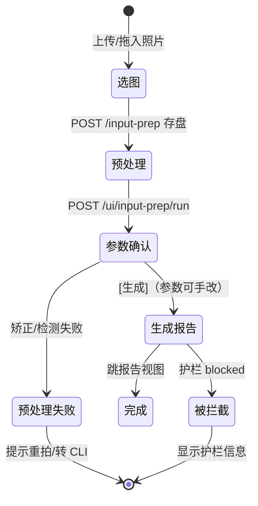

# ui-v1.md - 本地工作台 UI（D-111）

> 所属模块：交互层 · 本地工作台 ｜ MVP 优先级：P1（D-106 主线之外的体验增强，双核心链路不变）
>
> **版本**：v0.3.1　**更新日期**：2026-10-21
>
> 本文按四层结构编写：**设计层**（是什么、绝对不做什么）→ **控制层**（视图与交互流转，含异常路径）→ **工程层**（用什么、不要什么）→ **验收层**（怎么算完成）。Spec 定稿后写代码完全以本文为准，不依赖口头补充；未定的事在文末「未决事项」显性列出，不留隐藏假设。

---

# 第一层：设计层（是什么、不是什么）

## 1.1 定位

本地工作台 UI 是 明镜 单用户本地工具（D-106）的**可视化操作层**：给已有的 FastAPI 接口套一个浏览器壳，让三条已有链路（输入预处理 → 报告生成 → 报告问答）在网页里完成，质量门结果从 run.json 里搬上主视图。

触发背景（D-111）：CLI 形态的三个真实摩擦——看不到渲染产物、质量门结果要翻 JSON、手机不可用（ENG-CLI-005 移动端可读够不着）。

## 1.2 设计原则

- **壳，不是产品**：UI 零业务逻辑，只做表单 → API → 展示。所有质量判断、渲染、校验仍在后端，UI 不复制任何口径
- **质量门可视化是主视图**：G1 结果、unanchored_statements、照搬核对、needs_human 以红色高亮呈现，一眼可见（面试展品的「企业级质量门」证据展示成本归零）
- **沿用 D-106 口径**：报告编辑 = 落盘 md 人工编辑后重新渲染；问答 = 应答准备（只读），不做应答发送
- **展示品质是一等功能**（v0.2.0，D-018）：空状态、加载骨架、品牌层、与报告产物（D-110 米色鎏金）同族的视觉体系是验收项，不是锦上添花——本工作台同时承担求职作品集演示职能

## 1.3.1 审核备注（v0.1.2）

追溯链每条目（观察/信号块/假设/accepted claim/needs_human/复核项）支持**打勾 + 备注**，供疗愈师逐条审核留痕：

- 状态落 run 目录 `review.json`（`items: {key: {checked, note}}` + updated_at），本地文件随报告走，不进报告产物
- key 规则：`obs:{observation_id}`、`claim:{claim_id}`、`hyp:{kind}:{pattern_id或序号}`、`flag:{g1字段}:{序号}`、`sig:{序号}`、`general`（整份报告总评注）
- 审核是**个人工作痕迹**，不触发任何后端重算；删除 review.json 即清空，可整份复制给第二人复审

## 1.3 绝对不做（Hard Boundaries）

1. **不做账号/权限/分享**：仅 localhost 个人使用，无登录无多租户（D-106 砍项不变）
2. **不做前端工程**：无框架（不引 React/Vue）、无构建链（不引 npm/vite）、无 CDN 依赖，单目录静态文件由 FastAPI StaticFiles 托管
3. **不在线编辑报告 AST/结构化字段**：md 编辑就是文本编辑，重渲是后端确定性渲染（D-110）
4. **不绕过质量门**：UI 只展示 g1 结果与人工复核清单，不提供「强制通过」按钮
5. **不新增模型调用路径**：UI 触发的每个动作都对应一条已有后端链路，不喂新 prompt
6. **不做应答发送**：问答视图只生成应答准备稿，发送是疗愈师自己的事（wf-report-qa 口径）

## 1.4 与下游契约

- 报告生成：复用 `POST /report-gen`（图片路径 + ring_params + 主题）
- 输入预处理：新增 `POST /ui/input-prep/run`（单图流水线：矫正→裁切→基准圆检测→圈界提议），复用 input_prep 四模块，不经 AI（input-prep spec §1.4）
- 问答：复用 `POST /report-qa` 与 `GET /report-qa/turns`
- 渲染：复用 `render_report_html`（D-110），编辑保存后自动重渲

---

# 第二层：控制层（视图与交互流转）

## 2.1 视图总览

左侧边栏导航（v0.3.0，D-019），按「工作台 / 服务 / 成长 / 底座 / 项目」分组，**live 与规划中模块同栏呈现**——完整产品形态本身就是展示品：

- **live**：首页（dashboard：问候、最近个案、AI 课程卡、产品地图）｜个案（默认主战场，含「新建个案」二级视图）｜问答｜知识库（概览 + 知识图谱嵌入）｜关于本项目
- **规划中**（统一空状态页：曼陀罗线稿 + 模块定位 + 与 live 功能的关系 + 决策依据编号，零后端）：来访者（档案/预约/个案准备/个案督导）｜教学复盘（D-011⑧）｜私教陪跑（面向疗愈师）｜智能体（含两个已上线 agent 卡）｜质量评测（含 eval 实测数据）

侧栏深色暖墨棕底，底部健康状态点（/health）；可折叠为纯图标细条。移动端降级为顶部横滑导航。

「关于本项目」是纯静态叙事页（零后端）：项目定位、架构三层、评估指标摘要、决策日志精选、边界与隐私声明——作品集演示的收尾画面与陌生访客的导览。

## 2.2 新建视图

**两种输入模式**（v0.1.4，2026-09-29 教训驱动：用户上传已含三圈标记的定稿图时，自动预处理会再叠一套错位圈界，且旧标记被感知层误读为画作内容）：

- **原始照片模式**（默认）：上传 → `/ui/input-prep/run` 自动预处理 → 叠加图确认五参数（现有行为）
- **已定稿图模式**（勾选「照片已含三圈标记/已定稿」）：跳过预处理，复用 `/input-prep` 仅存盘 → 前端本地预览原图（ObjectURL，不经服务器）→ 五参数留默认值（图心 + R=短边×0.47 + r1=0.28/r2=0.60，与后端缺省一致）由用户手改 → 直接生成。已含标记线的图绝不再画叠加圈

- **预处理区**：显示叠加图（绿=基准圆，蓝=提议圈界）+ 五参数表单（cx / cy / radius / r1_ratio / r2_ratio，默认取提议值，可手改）
- **生成区**：主题（必填）、背景（可选）；提交后转圈等待（报告生成是分钟级同步调用），完成自动跳报告视图并选中该报告
- **异常路径**：护栏 blocked → 显示 guard.message，不生成；预处理失败 → 显示错误，提示转 CLI 手动路径

## 2.3 个案视图（v0.3.1 重排：报告本体首屏）

- **左栏**：栏顶「+ 新建个案」主按钮（进新建二级视图）+ 折叠按钮；个案列表（/ui/reports，按时间倒序），每行显示「来访者 · 主题」（无来访者称呼的存量 run 仅主题）、时间、质量徽标（口径按链路分：gen-audit run 按 status，stage35 run 按 g1，UI-013）+ 徽标图例行；栏可向左收起为细条。
- **主区**（选中后，v0.3.1：**报告本体即首屏**，疗愈师视角优先；工程元数据整包折叠，面试官视角展开仍有全部深度）——
  1. 标题行：来访者 · 主题 + 质量徽标 + 合规摘要 chips（启发式解析 audit.md：合规状态 + 超纲条数，仅展示指引）
  2. 报告正文：iframe 嵌入 /ui/reports/{id}/html（约 72vh；无 html 的旧 run 退回画作预览）
  3. 操作四按钮：[新标签打开报告] · [编辑 md]（textarea 载入 report.md，保存 = PUT，保存后自动重渲并刷新 iframe）· [重新渲染] · [去问答]
  4. 技术详情（details 折叠）：质量卡（gen-audit run 显示链路/状态/audit.md 指引；stage35 run 显示 g1 各计数）+ Round 详情（耗时/token/费用；未计时步与≈0 的「其余」行不显示）
  5. 追溯链（常展）：链路步骤卡（gen-audit 三步，结构由 /pipeline 下发），每步 工具/输入/输出/耗时 + [查输入]/[查输出]/[表格] 三按钮
- **右栏**：证据与审核——步骤查看器 + 总评注（带自动保存状态行：编辑中…/已自动保存 HH:MM/失败红字）+ gen-audit run 的证据面板（audit.md 与 report.md 以轻量 md 渲染成 HTML 表格/列表，不再裸贴原始 markdown）/ stage35 run 的复核清单与 ①~⑦ 证据面板（仅历史浏览）
- **空态**：未选中个案时右栏整列收起（no-panels），主区引导空状态占满；列表为空时显示新建引导

## 2.4 问答视图

- 报告选择器（选项显示「来访者 · 主题 · 日期」，同报告列表数据源）→ 轮次历史自动加载（/report-qa/turns）
- 提问框 + 场景切换（advisor 解读参谋 / reply_prep 应答准备）→ POST /report-qa → 回答渲染在对话流
- 空态给出两个可点击的示例问题（按场景切换），点击填入输入框；提问失败保留问题并给出「重试」按钮
- 回答若含口径提醒，原样展示（后端已负责追加，UI 不二次加工）

## 2.5 全局异常

- 后端不可达：状态条红色，所有提交按钮禁用
- 任意 API 4xx/5xx：错误文本就地展示，不吞错

---

# 第三层：工程层（用什么、不要什么）

## 3.1 技术形态

| 项 | 选型 | 理由 |
|---|---|---|
| 前端 | 单 `ui/` 目录：index.html + app.js + style.css，原生 JS | D-111 边界②：零框架零构建 |
| 托管 | FastAPI `StaticFiles(html=True)` 挂载在 `/`（最后注册） | 一个进程搞定，无单独静态服务器 |
| 新增 API | `backend/app/ui_api.py`，前缀 `/ui` | 与现有 main.py 薄路由分层一致 |
| 状态 | 无前端状态库，JS 模块级变量 | 单用户本地，刷新即重置可接受 |

## 3.2 新增端点

| 端点 | 方法 | 说明 |
|---|---|---|
| /ui/knowledge-graph | GET | 伺服 ranran 仓 knowledge/healing/本体/语义层/graph.html（只读，知识库页 iframe 嵌入；文件缺失 404） |
| /ui/reports | GET | 扫描 runs/ 返回摘要列表（report_id、status、theme、started_at、elapsed_ms、g1 计数摘要、has_report_html） |
| /ui/reports/{id} | GET | run.json 摘要 + report.md 全文 |
| /ui/reports/{id}/html | GET | 伺服 run_dir/report.html（不存在则 404） |
| /ui/reports/{id}/image | GET | 伺服 run.json input.image_path（路径校验：必须是已存在的绝对路径文件） |
| /ui/reports/{id}/report-md | PUT | 保存编辑后 md → 自动 render_report_html 重渲 → 写 run.json edited_at → 返回 render_ms |
| /ui/reports/{id}/re-render | POST | 从当前 report.md 重渲 report.html |
| /ui/reports/{id}/step/{n} | GET | 追溯链单步输入/输出全文（UI-012）：LLM 步输入 = prompts/ 落盘的 prompt 原文，**缺失时由现行代码 + 该 run 中间产物重建**（D-114，响应带 rebuilt 标注，不冒充原件）；程序步输入 = 固定白名单源文件；输出 = 该步产物文件（超大文本截断 150k） |
| /ui/reports/{id}/trace | GET | 追溯链全量：run_meta（模型/耗时/token）+ run 目录内已落盘的中间产物（缺失容忍，缺什么返回什么）；gen-audit run 的证据链是 audit.md，由 /ui/reports/{id} 全文提供 |
| /ui/reports/{id}/pipeline | GET | 链路结构元数据下发（UI-013）：gen-audit-v1 run 返回三步的名称/工具/输入说明/逐步耗时/token/产物存在性（源：`_STEP_META` + run.json）；旧 stage35 run 返回 legacy 标记 + 降级提示。前端不复制链路口径 |
| /ui/reports/{id}/review | GET | 审核备注全量（review.json，无则空对象） |
| /ui/reports/{id}/review | PUT | 单条 upsert：{key, checked?, note?}；key 为条目稳定标识（obs:V-001 / claim:C-900 / hyp:{kind}:{id} / flag:{field}:{序号} / general），白名单校验 |
| /ui/input-prep/run | POST | 单图流水线（rectify→crop→detect→propose_rings），产物落 state/input-prep-ui/，返回 image_path + ring_params + overlay_url |

## 3.3 不要什么

- 不要 WebSocket/轮询进度：报告生成同步等待即可（分钟级可接受，加转圈与耗时提示）
- 不要前端路由库：三个标签 = 三个 div 显隐
- 不要把 golden/eval 链路接进 UI：评测是 CLI 工程链路，不在工作台范围

---

# 第四层：验收层（怎么算完成）

| 编号 | 条目 | 通过标准 |
|---|---|---|
| UI-001 | 三视图可用 | localhost 打开首页，侧栏导航切换正常，/health 状态点正确 |
| UI-014 | 完整产品形态（v0.3.0） | 侧栏分组导航含 live 与规划中模块（规划中页带定位/关系/决策依据，零后端）；首页 dashboard 含最近个案/AI 课程卡/产品地图；知识库页嵌入图谱可交互；/ui/knowledge-graph 200 |
| UI-015 | 疗愈师视角重排（v0.3.1） | 新建表单有「来访者称呼（可选）」，传入 run.json input.client 并在列表/标题/问答选择器显示「来访者 · 主题」；个案详情首屏为报告 iframe，质量卡与 Round 详情折叠进「技术详情」；audit.md/report.md 面板渲染为 HTML 而非裸 markdown；总评注有自动保存状态反馈 |
| UI-002 | 新建链路 | 上传照片→预处理出叠加图与五参数→生成报告→自动跳报告视图 |
| UI-003 | 质量门可视化 | 报告视图红色高亮 unanchored/照搬/orphan >0 项，与 run.json 一致 |
| UI-004 | 编辑重渲 | 编辑 md 保存后 report.html 更新，run.json 记 edited_at，渲染 <10s（D-110 已保证 ms 级） |
| UI-005 | 问答链路 | 选报告提问→回答展示→轮次刷新可见，reply_prep 场景可用 |
| UI-006 | 移动端可读 | 手机浏览器打开，三视图可用（响应式单列布局） |
| UI-007 | 零新增失败 | backend 全量测试绿，新增测试覆盖 ui_api 纯函数部分 |
| UI-012 | 步骤可追溯 | 报告视图三栏；链路每步 [查输入]/[查输出]/[表格] 三按钮可用：LLM 步能看到 prompts/ 落盘的 prompt 原文，程序步能看到对应源文件；[表格] 定位到右栏对应面板；旧 run 无 prompts/ 时显示"未记录"提示 |
| UI-011 | 已定稿图模式 | 勾选后不上预处理、不画叠加圈；原图本地预览可见；五参数可手改；生成报告用的是上传原图路径 |
| UI-010 | 链路可视 | 追溯面板顶部有链路步骤（gen-audit 三步：生成→核查→渲染），每步显示工具（模型/程序）、输入、输出、耗时/token，数字与 run 产物一致 |
| UI-009 | 审核留痕 | 追溯链各表每行有打勾框与备注输入，改动即落 review.json；刷新后状态保留；总评注区可用 |
| UI-008 | 追溯链可视 | 报告视图可见证据链与核查信息（gen-audit run 为 report.md + audit.md 合规/超纲表；旧 stage35 run 的四层证据链仅历史浏览）；与 run 目录产物一致 |
| UI-013 | 前后端链路口径一致 | 追溯链步骤结构由 /ui/reports/{id}/pipeline 下发（后端 `_STEP_META` 唯一定义）：gen-audit run 显示三步（生成→核查→渲染）且耗时/token 与 run.json 一致；旧 run 显示 legacy 降级提示；徽标按链路分口径（gen-audit 按 status，stage35 按 g1） |

---

## 未决事项

（登记 2026-10-19：审核备注 key 体系 obs/claim/hyp/flag/sig 对应已退役链路，gen-audit run 当前仅 `general` 可用；审计条目级备注随 task 013 三结构改造重做）

1. **报告生成的进度展示**：同步等待只有转圈，分钟级无反馈感。是否加「阶段提示」取决于后端是否暴露阶段事件——本期不做，体感差再议。
2. **问答场景的 override/regenerate 操作**：FOLLOWUP_ACTIONS（regenerate/reclassify）本期只在返回里展示，UI 暂不接操作按钮。
3. **多报告对比**：同一张画多次 run 的并排对比（骨架 v2 稳定性批次的数据查看器）需要时再开。
4. **追溯链的 claim→报告句映射粒度**：v0.1.1 提供 report.sourced.md（〔来源：X〕行级标注）+ claims 明细两张视图，句级双向跳转（点 claim 高亮报告句）需要报告成文侧带锚点，留待写作层改造。
